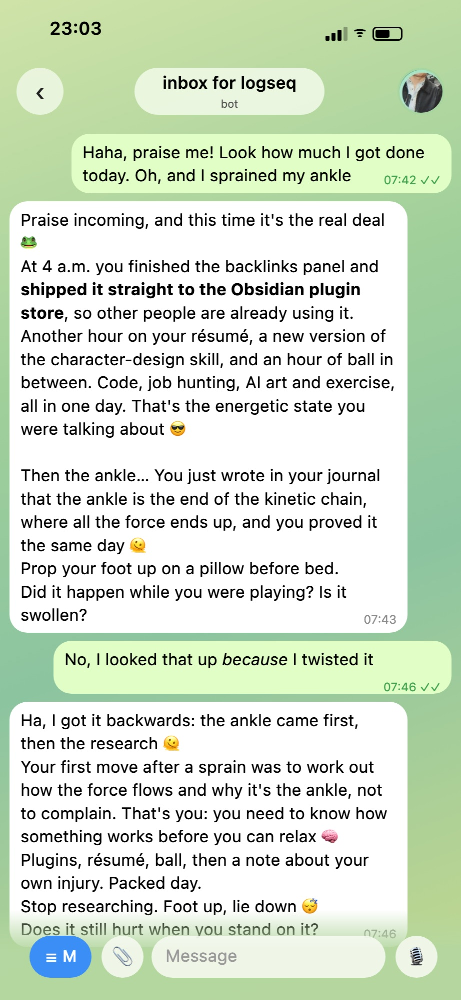
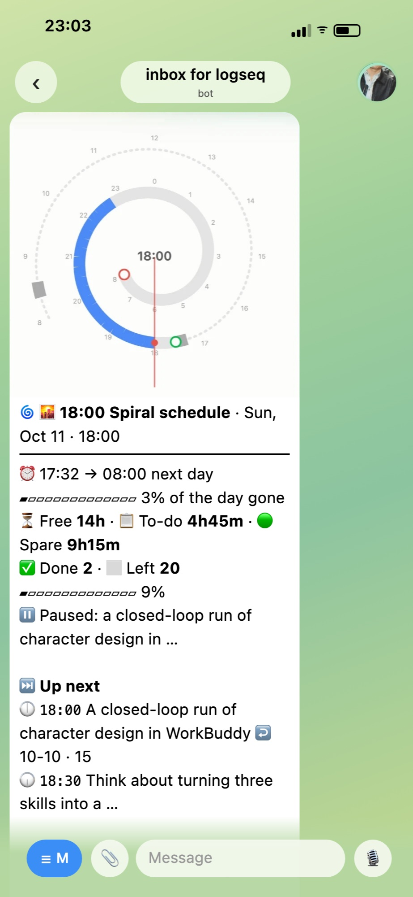

# Telegram Companion

[中文说明](README.zh-CN.md) · [Getting started guide (Chinese)](docs/上手指南.md)

A Telegram bot for your Obsidian vault that does two things. Everything you send it lands in today's daily note, and when you want to talk, it answers as a friend who has read your recent notes. It keeps a small profile note about you that grows over time, and you choose which model sits behind it: Claude Code CLI, the Anthropic API, or any OpenAI-compatible endpoint, including a local Ollama.

It is a modified version of the community plugin [Telegram Inbox](https://github.com/icealtria/obsidian-telegram-inbox), which saves messages sent to your own Telegram bot into your daily note. This version adds a character on the other end of the inbox who has read your notes. It can see what you are doing today, what you have been busy with all week and what you plan to do next. So when you say "I'm exhausted" it does not answer with a generic "hang in there", and when you say "done!" it knows what you finished.

The settings and the bot's built-in messages are in Chinese. The language of the model's replies is a setting.

## What it does

| Your situation | What it does |
|---|---|
| An idea arrives and only your phone is at hand | Send it to the bot in Telegram. Text, photos and links go straight into today's daily note |
| You want to talk, but an AI chat needs you to explain what you have been doing first | It reads the last week of your daily notes before answering |
| AI chats repeat themselves after a while | It remembers what it said recently and does not bring the same thing up again |
| Every AI has the same customer-service voice | The default persona is warm and on your side. You can write a note that makes it play someone else, and teach it your own catchphrases |
| It forgets what you told it last time | After a chat it writes new facts into a profile note, and rewrites the recent part every week. Long-term traits are only added after you approve them |
| You want to know what you did today | Say "睡了" (going to sleep) and it replies with a summary: what got done, what to start with tomorrow |
| You do not want to be tied to one model provider | Switch between Claude Code CLI, the Anthropic API and OpenAI-compatible endpoints at any time. With a local Ollama, your notes never leave your computer |

## Screenshots

  
  

**Left: chat mode.** The message was "Praise me! Look how much I got done today, and I sprained my ankle." Everything it praises is in that day's daily note: finishing the backlinks panel and shipping it at 4 a.m., working on a résumé, updating a skill, an hour of ball. It got the order of the sprain and the research backwards, corrected itself when told, and asked whether it still hurts to stand on.

**Right: used together with [Nautilus Spiral](https://github.com/MatsuriMW/nautilus-spiral).** At a few fixed times a day it sends today's spiral to your phone: how much of the day is gone, how much time is left, whether the to-dos still fit, and what to do next.

Both are real conversations from the author's own use, originally in Chinese and translated here ([original screenshots](README.zh-CN.md#用起来是什么样)). In chat mode the bot replies in whatever language you write in; the Nautilus Spiral push is currently in Chinese only.

## Installation

Desktop only. The bot runs inside Obsidian on your computer, so Obsidian has to be open for it to answer. Messages sent while the computer was asleep are picked up when it wakes.

- From the community plugin directory: open **Settings → Community plugins → Browse**, search for "Telegram Companion", then install and enable it.
- Manually: download `main.js`, `manifest.json` and `styles.css` from the [latest release](https://github.com/MatsuriMW/telegram-companion/releases/latest) into `<your vault>/.obsidian/plugins/telegram-companion/`, then enable the plugin under **Settings → Community plugins**.

## Usage

1. In Telegram, message `@BotFather`, send `/newbot`, and copy the token it gives you.
2. Open the plugin settings. Paste the token into **Bot token**, and put your Telegram username (without `@`) or numeric ID into the allowlist field (labelled 白名单). Only people on that list are answered. The status at the top right shows the bot's name once it is connected.
3. Send the bot any text, photo or link. It is written into today's daily note. The folder and date format follow the Daily notes core plugin (or Periodic Notes).
4. For the companion part, pick a model backend in the section labelled 背后的模型 (see [Model backends](#model-backends)). The test button in that section confirms the connection.
5. Send `/chat` to start talking and `/record` to go back to capturing. `/help` lists every command.

### Two modes

- **Record mode** (default): whatever you send is saved, as in the original inbox.
- **Chat mode**: it answers every message, following the conversation. Chat messages are not written to the daily note.

Chat mode starts when you send `/chat`, when you send an emotional message, when you send one of your greeting catchphrases, or when you reply to one of its messages. If it started on its own, it returns to record mode after 20 minutes of silence (configurable) and tells you so.

### Commands

| You send | It does | Saved to the daily note |
|---|---|---|
| Any text, photo, link or voice message | Saves it to today's daily note, timed by when the message was sent. With list mode on, each line becomes a list item; lines that already are list items (`•`, `1、`, `①` and the like) keep their own marker and indentation. Optionally the first line gets the time it arrived, and forwarded messages get a tag | Yes |
| `/chat`, `/record` | Enters or leaves chat mode | No |
| `/summary` | Summarises today without ending the day | No |
| `/mode` | Says which mode it is in | No |
| `/model` | Shows the current model, with buttons to switch | No |
| `/persona` | Shows the current persona, with buttons to switch | No |
| `/me` | Shows what it currently knows about you | No |
| `/profile` | Re-reads this week's notes and updates the profile | Updates the profile note |
| `/task text` | Adds a to-do | Yes |
| `/help` | Lists the commands | No |

Most commands also have a Chinese phrase (for example "对话模式" for `/chat`, "睡了" to end the day and get the summary). The full list is in the [Chinese README](README.zh-CN.md).

### Tasks

Tasks in your daily note can be Markdown checkboxes (`- [ ]`, `- [/]`, `- [x]`) or keywords (`- TODO`, `- DOING`, `- DONE`). It reads both.

### Persona, catchphrases and the profile note

- **Persona**: by default it is a caring character who is on your side and does not nag. Turn on the persona setting to make it follow a note you write instead: who it is, what it calls you, how long its replies are. Point the setting at a folder to keep several personas and switch between them with `/persona`.
- **Catchphrases**: greetings and thanks do not need a model. For each trigger word you choose an instant reply: a greeting that mentions what you are doing, an echo, or a random line from a list you wrote.
- **Profile note**: one note in your vault that describes you. You write the long-term part. A section at the end is maintained automatically: updated after a chat in which you said enough, and rewritten every Sunday. Changes to the part you wrote are sent to Telegram with approve / reject buttons and are only applied when you approve.

Rules that hold whatever the persona or profile says: it responds only to your own affairs and does not apply other people's words quoted in your notes to you; it brings up self-harm resources only when you explicitly say you want to hurt yourself in the current conversation; and when the model cannot be reached, it says so right away.

A persona also gets a few red lines that come before anything the persona note says: every character is an adult (18 or older) and is not played childlike; it can be sweet and flirty but never sexually explicit; it does not make money, medical, legal or safety decisions for you, only points out the risks; and it does not play a character that manipulates you or encourages harm. These are instructions to the model, so they are not guaranteed. The one check the plugin does itself: a persona note that states an age under 18 or says the character is a minor is not used, and the default persona answers instead.

## Model backends

Chat replies, summaries and profile updates call a large language model. Choose one backend in the settings:

| Backend | What you need | Good for |
|---|---|---|
| Claude Code CLI | [Claude Code](https://claude.com/claude-code) installed and logged in on this computer; no key | People with a Claude subscription |
| Anthropic API | An API key and a model name | Paying per use for Claude |
| OpenAI-compatible endpoint | A base URL, a key and a model name. DeepSeek, OpenAI, OpenRouter and a local Ollama all work | Other providers, or keeping data on your computer with Ollama |

You can fill in all three and switch at any time, in the settings or by sending `/model` in Telegram.

**Fallback backend.** Pick a second backend under 备用后端 and the bot keeps answering when the first one fails, for example when a subscription's usage limit is reached, a request times out, or a login expires. The failed request is retried once on the fallback, and the reply ends with a line saying which model answered and why the first one did not. For the next 10 minutes requests go straight to the fallback, then the first backend is tried again.

**Where your data goes.** For each reply the plugin sends your profile note, the persona note and a digest of the last week of daily notes (task lines and top-level items, no attachments) to the model service you chose (or to the fallback backend, when one is set and it answered), and to no one else. API keys are stored in the plugin's own `data.json`. If your vault is synced to a public place, exclude that file.

## Works with Nautilus Spiral

The plugin works on its own. Together with [Nautilus Spiral](https://github.com/MatsuriMW/nautilus-spiral), a plugin by the same author that draws today's events and to-dos as a spiral schedule, it does more:

- Send `?` to get today's spiral and what is next.
- "起了" (got up) and "睡了" (going to sleep) mark the start and end of the day.
- "去吃饭了" (going to eat), "去锻炼了" (going to work out) and "午睡" (nap) pause the timers of running tasks. Saying you are back resumes them.
- `done 写稿 2h` and `doing 写稿` update the matching task in today's note (this one also needs the done-to-top plugin).

Without these plugins the phrases above are saved like any other message, and everything else works the same.

## Network use, accounts and local programs

- **Network**
  - Telegram Bot API (`api.telegram.org`): receives the messages you send to the bot, sends replies, and downloads photos and files from messages.
  - The model service you chose: `api.anthropic.com` for the Anthropic API, or the base URL you entered for an OpenAI-compatible endpoint. With a local Ollama nothing leaves your computer. If a fallback backend is set, the same content goes to that service instead when the first backend fails.
  - Nothing else. There are no analytics and no telemetry.
- **Accounts**: a Telegram account to create the bot. The companion features need an account or API key for a model service, or a local Ollama. Using it only as an inbox needs no model.
- **Local programs**: with the Claude Code CLI backend, the plugin starts the `claude` program installed on your computer to generate replies, using that program's own login. Other backends start no programs.
- **Files outside the vault**: none are read or written.

## Requirements

- Your own Telegram bot (free, from @BotFather).
- Daily notes: it reads Obsidian's daily notes, following the Daily notes core plugin or Periodic Notes. It reads top-level lines and task lines; indented detail below them is not read.
- A model backend for the companion features.
- Obsidian on desktop, running.

It is not therapy and does not replace the people around you.

## Credits and license

Based on the community plugin [Telegram Inbox](https://github.com/icealtria/obsidian-telegram-inbox) by [icealtria](https://github.com/icealtria). The original inbox, media download and message templates are kept. This version adds the two modes, the companion, personas, catchphrases, the profile note and the switchable model backends. The source changes are in this repository's commit history. The original is released under GPL-3.0, and so is this version: [GPL-3.0](LICENSE).
