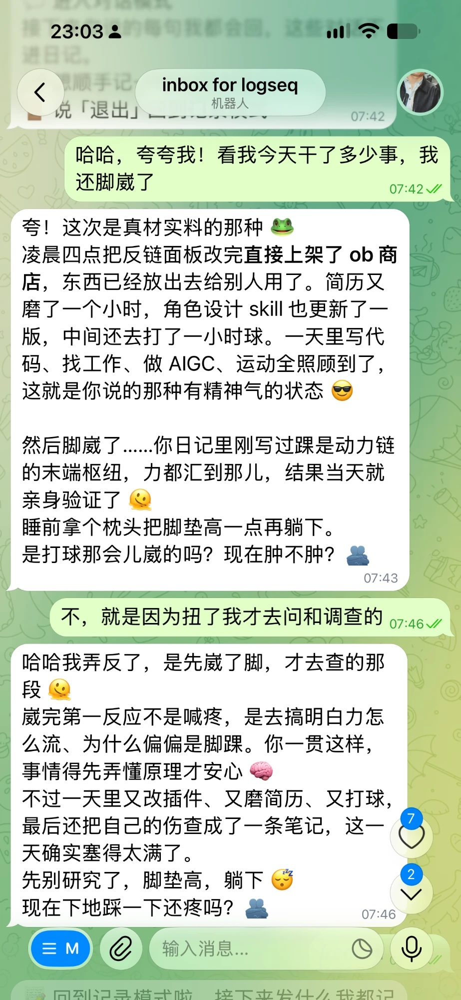
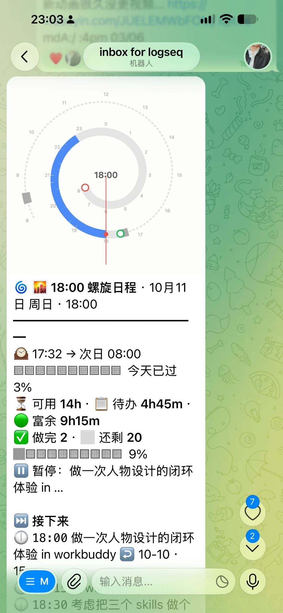

# Telegram Companion

**目录**

- [English](README.md)
- 先看这里：[它能做什么](#它能做什么) · [用起来是什么样](#用起来是什么样) · [为什么做](#为什么做) · [需要什么](#需要什么) · [你发什么，它做什么](#你发什么它做什么)
- 它怎么陪你：[两种模式](#两种模式记录和对话) · [它怎么回你](#它怎么回你) · [人设](#人设它是谁) · [口癖](#口癖你自己的说法) · [陪伴档案](#陪伴档案它对你的了解) · [记忆](#记忆它怎么记住你)
- 配置和搭配：[任务怎么写](#任务怎么写) · [背后的模型](#背后的模型) · [和螺旋日程一起用](#和螺旋日程一起用效果最好) · [联网、账号和本机程序](#联网账号和本机程序)
- 其它：[致谢与许可](#致谢与许可)
- 第一次用：[上手指南](docs/上手指南.md)

社区插件 [Telegram Inbox](https://github.com/icealtria/obsidian-telegram-inbox) 的改版。原版做一件事：发给自己的 Telegram 机器人的消息，自动记进 Obsidian 今天的日记。

这一版给收件箱的另一头加了一个读过你日记、爱你也关心你的角色。它看得到你今天在做什么、这一周一直在忙什么、接下来打算做什么，所以你说「好累」，它不会回一句空泛的「加油」；你说「搞定了」，它知道你搞定的是什么。

推荐度 ★★★：收件箱装上就能用；陪伴的部分再配一个模型后端就能用（三种任选，见「背后的模型」）。第一次用请看 [上手指南](docs/上手指南.md)。

## 它能做什么

| 你遇到的事 | 它怎么办 |
|---|---|
| 想法来了手边只有手机，打开 Obsidian 记一笔太慢 | 在 Telegram 里发给机器人，文字、图片、链接都直接进当天的日记 |
| 想找个人说句话，可打开 AI 得先解释一遍「我最近在忙什么」 | 它先读你近一周的日记再开口，知道你在做什么、卡在哪、接下来打算干嘛 |
| AI 聊久了翻来覆去就那几句 | 它记得自己最近说过什么，提过的事不再提，今天的聊完了就从这一周里换个角度 |
| 每个 AI 都是同一副客服腔 | 默认是一个爱你、关心你的角色；也可以写一篇笔记让它扮演别人，还能教它你自己的口癖 |
| 上次聊过的事，下次它又不知道了 | 聊完把新知道的事记进一页「陪伴档案」，每周再整体更新一次；长期的画像要你点头才改 |
| 睡前想知道今天到底干了些什么 | 说一声「睡了」，它回一条小结：做成了什么、明天先做哪件 |
| 不想被绑在某一家模型上，也不想日记到处传 | 模型自己选，Claude 命令行、Anthropic API、OpenAI 兼容接口随时切换；接本机的 Ollama，日记就不出你的电脑 |

## 用起来是什么样

作者自己每天在用，下面是两张没摆拍的截图。

  
  

**左：对话模式。** 发了一句「夸夸我！看我今天干了多少事，我还脚崴了」。它夸的每一件都是当天日记里记着的：凌晨改完反链面板并上架、磨简历、更新一个 skill、打了一小时球。它把崴脚和查资料的先后猜反了，被纠正后马上改口，接着问现在踩地还疼不疼。

**右：和螺旋日程一起用。** 每天几个固定时刻，它把今天的螺旋图发到手机上：这一天过了多少、还有多少时间可用、待办排不排得下、接下来该做哪件。

## 为什么做

手机上最顺手的输入框是聊天软件。想法、截图、链接、一句情绪，随手发给机器人就进了日记，不用打开 Obsidian。

日记记得越多，就越希望对面能回应一下。人在两种时候最想有人接一句：累到不想动的时候，和开心到想跟人分享的时候。这两种时候，打开一个 AI 聊天窗口、从头解释「我最近在忙什么」太累了，而你的日记里早就写着答案。所以让机器人先读日记，再回你。

## 两种模式：记录和对话

- **记录模式**（默认）：发什么记什么，和原版收件箱一样。
- **对话模式**：每句话它都会接着前面的话回你。对话内容不进日记：聊天归聊天，日记还是你自己写的那份。

怎么进、怎么出：

- **自己说**：发「对话模式」「陪我聊天」或 `/chat` 进入，一直保持到你说「退出」「记录模式」「不聊了」，或者说「睡了」收工。
- **自动进入**：发情绪话（好累、好难受、好开心、想某个人……）、你设成「回完进入对话模式」的口癖（默认是你好、在吗这类招呼）、以「聊聊」「陪我」开头，或者回复它的某条消息，都会自动进入。自动进入的，20 分钟没说话就自己回到记录模式，并告诉你一声（时长在设置里改）。
- **对话里也能记**：`done` / `doing`、图片、带链接的消息照常记；想把某一句记进日记，用「记 」开头。

## 它怎么回你

每次回复之前，它会读这些：

1. **陪伴档案**：你写给它的一页笔记，写着你是谁、累的时候通常因为什么、希望被怎样回应。
2. **近一周的日记**：今天的最细，越早越粗。它从里面看三件事：你一直在做什么（好几天都出现的）、最近在做什么、接下来打算做什么（待办和你写下的计划）。
3. **这次对话**，以及**最近一天它自己说过的话**。

第三条是为了不来回说同一件事。提过的事、夸过的点、用过的句式，它不会再说一遍，除非你自己接着聊那件事；今天的日记聊完了，它就往这一周里找没聊过的角度。

几条写死在代码里的原则，不管档案怎么写都会遵守：

- 只回应你自己的事。日记里别人说的话、你摘抄转述的内容，不会被拿来套在你身上，也不会提别人的隐私。
- 只有你这一次明确说出想伤害自己、不想活，才会认真接住并请你联系身边的人或求助热线；日记里出现过相关的词，不会让它主动提起。
- 模型连不上时，回一句简短的陪伴话，并告诉你是哪里没连上，不会让你等半天没有回应。

要等的回复（读日记、调模型，大约 8～30 秒）不会让你干等：它马上先回一条「💭 收到，在想……」，每隔几秒换一句进度，写好后这条提示消失，正式回复作为新消息发来。用新消息是为了你切出聊天后手机也会响。

## 任务怎么写

日记里的任务有两种写法，它都读得懂，可以混着用：

| 写法 | 没做 | 在做 | 做完 |
|---|---|---|---|
| Markdown 复选框 | `- [ ] 写稿` | `- [/] 写稿` | `- [x] 写稿` |
| 关键词 | `- TODO 写稿` | `- DOING 写稿` | `- DONE 写稿` |

关键词写法是从 Logseq 和 Org-mode 带过来的，作者自己一直这么记，所以文档里的例子多半是 `TODO` / `DONE`。你习惯用 Markdown 复选框就照旧用：它读日记、打招呼时说「今天做完几件」、写小结、更新近况，两种都认；`/task 内容` 记下来的就是一条 `- [ ] 内容`。

## 人设：它是谁

默认的人设是一个爱你、关心你的角色，带着母亲那样的温柔：无条件站在你这边，看得见你的辛苦，也相信你。这份关心是给成年人的，不唠叨、不催、不说教。

想换一个，在设置里打开「人设」，让它照一篇笔记里写的角色回你。角色扮演、语 C、换一种语气都行：角色是谁、怎么称呼你、动作要不要写在括号里、一次回几行，全由那篇笔记说了算。点「新建模板」会生成一份可以照着填的。

- **多个角色**：把「人设笔记」填成一个文件夹，里面每篇笔记写一个角色。在 Telegram 里发「人设」或 `/persona`，点按钮切换，或者切回默认。
- **它还读日记吗**：读。角色知道你今天在做什么，会用自己的口吻说出来；不想让它提日记，在人设笔记里写一句「不要提日记里的事」。
- **人设管不到的**：收工小结只有最后那几句话换成角色的口吻；口癖的即时回复和机器人的固定提示语不变。

不管人设怎么写，这几条不会变：不来回说同一件事；不拿日记里别人的话套在你身上；你明确说出想伤害自己的时候，它会放下角色认真回应。

人设还有几条红线，比人设笔记里写的优先：角色一律是成年人（18 岁以上），不演幼态；可以甜、可以暧昧，但不写露骨内容；钱、医疗、法律、安全上的事不替你拍板，只提醒风险；不演操控你、教唆伤害的人格。这几条是写给模型的要求，不能保证百分之百守住；插件自己会先查一条：人设笔记里明写未满 18 岁或未成年的，这份人设不会被用上，回你的还是默认的那个人。

## 口癖：你自己的说法

每个人打招呼、撒欢的说法不一样。有人说「在吗」，有人说「哈喽」，有人开心了就「呱呱呱」。这些话不值得等模型十几秒，所以在设置的「口癖」一节里自己定：整句话就是某个触发词时，它马上回一句，这句话也不记进日记。

每条口癖有触发词（可以写好几个，逗号隔开）和三种回法：

| 回法 | 它怎么回 | 例子 |
|---|---|---|
| 打招呼 | 按时间段问好，带上你正在做的事和今天做完了几件 | 你发「在吗」，它回「晚上好 🌙 / ⭐ 你在做「写稿」/ ✅ 今天已经做完 5 件了」 |
| 跟着说 | 你说几声，它多说一声 | 你发「呱呱」，它回「呱呱呱！」 |
| 回我写的话 | 从你写的几句里随机回一句 | 你发「谢谢」，它回「不客气呀 🫶」 |

每条还有两个开关：**回完进入对话模式**（打招呼通常开着，接下来说的话它都会接），和**开心**（表示你说这个词的时候心情好；句子里带着它，比如「呱呱 简历过了」，会自动进入对话模式，它也会跟着你高兴，模型还会学着用同样的词回你）。

默认带两条：招呼（你好、hi、在吗……）和道谢（谢谢、thanks……）。随便改、随便加。

## 陪伴档案：它对你的了解

陪伴档案是库里的一页笔记（路径在设置里填，可以点「新建模板」生成一份）。想改它说话的方式，就改这页，下一条消息就生效。

模板开头是一组基本信息：怎么称呼你、性别、年龄、教育程度、MBTI、职业、最近在关心什么。每一项都是选填的，不想说的空着或删掉，它会当作不知道，不会追问。填这些只为了让它在聊天时更了解你一点。这页只存在你自己的库里；生成回复时它会和日记摘要一起发给你选的模型，除此之外不去任何地方（模型选本机的 Ollama 就完全不出电脑）。

档案分两部分：上面是你手写的长期画像，末尾是一节自动维护的「🔄 近况」。它有三种更新方式：

- **聊完就整理**：对话结束时（你说退出、超时回到记录模式、或者收工），如果这段对话里你说的话够多（默认累计 150 个字，设置里可改），它会把其中新出现的事实并进「近况」：只改有变化的那几行，然后发一条消息告诉你记了什么。说得少就先攒着，等攒够了一起整理；寒暄和单纯的情绪话不会被记成事实。
- **每周日重写近况**：读这一周的日记、你指定的额外笔记（比如周报、项目复盘），以及这周在对话模式里你说过的话，整段重写「近况」。
- **长期画像要你点头才改**：上面两种更新如果发现了稳定的新特点（新的压力模式、喜欢怎样被回应、重要的人或目标），会发到 Telegram 问你，每条带「✅ 记进档案 / ❌ 不要」按钮，点了 ✅ 才写进你手写的那几节。你手写的部分它不会自己改。

对话模式里说的话只存在插件自己的数据文件里，不进日记和笔记，每周更新完就清空。不想让它参考对话，在设置里关掉「参考对话模式里你说过的话」。

## 记忆：它怎么记住你

它的记忆分四层，越往上越稳、越往下越短。日记不算在里面：日记是你的原始记录，它每次回你时去读，但不改。

| 层 | 存在哪 | 怎么写进去 | 留多久 |
|---|---|---|---|
| 长期画像 | 陪伴档案上面你手写的几节 | 你自己写；它只能提「建议补进档案」，你点 ✅ 才写进去 | 一直留着，只有你能改 |
| 近况 | 陪伴档案末尾的「🔄 近况」 | 聊完、你说的话攒够 150 字，就把新事实并进去；每周日整段重写 | 每周重写一次 |
| 这周的对话 | 插件自己的数据文件（`data.json`），不进日记和笔记 | 对话模式里你说的每句话 | 并进近况的打上记号；每周日更新完清空 |
| 这次对话 | 只在内存里 | 你们来回的消息，保留最近 16 条（约 8 个来回） | 退出对话、换人设就清掉 |

另外它记着自己最近 24 小时说过的话（最多 30 条），只用来避免来回说同一件事、夸同一个点；换人设时一起清掉。

想看它现在记得你什么，发 `/me`；想马上按这周的记录更新一遍，发 `/profile`。

### 每次回你，它带着什么

对话模式里，每条回复都会把下面这些一起交给模型：

1. **陪伴档案全文**：你手写的长期画像，加上「🔄 近况」。
2. **近一周的日记摘要**：今天最细（最多 120 行），前两天各 50 行，再往前四天各 30 行。只取任务行和顶格的条目，缩进的子条目、图片、超过 140 字的部分不带。
3. **近一个月里你说过的情绪话**：从昨天往前翻 30 天，找日记里像「好累」「好开心」这样的短句（60 字以内），最多 12 条，让它知道你最近几次低落或开心是什么时候。
4. **作息、训练这类数据**：装了「螺旋日程」「任务提醒」才有。
5. **这次对话的上下文**，以及它最近 24 小时说过、但不在这段对话里的话。

### 它不记什么、做不到什么

- **对话原文留不过一周**：每周日更新完就删，之后只剩近况里的摘要。这是为了隐私，代价是一个月前聊过的细节它不记得。
- **不翻整个库**：只看上面那几个固定的时间窗。一个月以前的事，只有写进档案才记得；情绪话是按关键词找的，不是按意思检索。
- **不记成事实的**：寒暄、单纯的情绪话，以及日记里别人说的话、摘抄和转述，都不会被当成你的事记进近况。
- **前后矛盾时**：没有专门的合并或遗忘规则，靠每周日重写近况时以这一周的记录为准；你手写的长期画像它不会自己改，过时了要你自己删。

## 背后的模型

陪聊、小结、更新档案都要调一个大语言模型。在设置的「背后的模型」里选一种后端：

| 后端 | 要准备什么 | 适合谁 |
|---|---|---|
| Claude 命令行 | 本机装好并登录 [Claude Code](https://claude.com/claude-code)，不用填 key；可以选 sonnet / opus / haiku 或填完整模型名 | 已经在用 Claude Code 订阅的人 |
| Anthropic API | 一个 API key 和模型名 | 想按量付费直接用 Claude 的人 |
| OpenAI 兼容接口 | 接口地址、key、模型名；DeepSeek、OpenAI、OpenRouter、本机的 Ollama 都是这一类 | 想用别家模型，或者想让数据留在本机（Ollama）的人 |

三种后端的参数可以都填好，然后随时切换：在设置里换，或者在 Telegram 里发「模型」，点按钮就切过去。设置里有一个「发一句测试」按钮，填完先点它确认连得上。

**备用后端**：订阅额度用完、接口超时、登录失效的时候，不想让它哑掉，就在「备用后端」里再选一个，它的参数就在下面填。主后端报错时它自动用备用的重试一次，回复末尾会注明这次是谁回的、主后端为什么没回；之后 10 分钟直接走备用，免得每条消息都先等主后端失败一遍，过了这段时间再从主后端试起。比如主后端用 Claude 命令行，备用选 OpenAI 兼容接口、接口地址选 DeepSeek，再填 DeepSeek 的 key 和模型名。

**你的数据去哪了**：每次回复，插件会把陪伴档案、人设和近一周日记的摘要（任务行和顶格条目，不含附件）发给你选的那家模型服务（设了备用后端、并且这次用到了它的话，是发给备用的那家），除此之外不发给任何人。API key 存在插件自己的 `data.json` 里；如果你的库会同步到公开的地方，记得把这个文件排除掉。

## 和螺旋日程一起用，效果最好

这个插件自己就能用。不过它和同一个作者的 [螺旋日程](https://github.com/MatsuriMW/nautilus-spiral)（Nautilus Spiral）是一起长出来的，两个放在一起才是完整的样子。螺旋日程把今天日记里的事件和待办画成一圈螺旋，算出今天还排不排得下；机器人把这张图和这些数带到了手机上：

- **随时看今天**：在 Telegram 里发 `?`，回你一张今天的螺旋图，加上正在做什么、接下来几件、哪些排不下。
- **用说话记作息**：`起了` 开始今天，`睡了` 收工。螺旋日程据此定这一天的起止，顺便算出昨晚几点睡、睡了多久。
- **离开一会儿不用开电脑**：`去吃饭了`、`去锻炼了`、`午睡`，正在做的事自动暂停计时；回来说 `吃完了`、`练完了`、`醒了`，再切回去。
- **在手机上勾任务**：发 `done 写稿 2h`、`doing 写稿`，直接改今天日记里对应的那条任务并补上时间（两种任务写法都能改；这一条还要装 done-to-top）。
- **聊天时它更懂你的状态**：陪聊和小结会读到今天做完几件、还剩多少、这几天几点收工，而不只是日记里的字。

螺旋日程已经提交 Obsidian 社区插件市场，在等审核；通过之前可以从它仓库的 [Release](https://github.com/MatsuriMW/nautilus-spiral/releases/latest) 手动安装。它那边的说明里也有一节「和 Telegram Companion 联动」，讲两边怎么配。没装的时候，上面这些口令只是照常记进日记，其它功能不受影响。

再加一个 [任务提醒](https://github.com/MatsuriMW/Obsidian-Plugins/tree/main/nautilus-notify)（nautilus-notify）的话，它会把定时的日程图、健身早报、拖了好几天的待办（带按钮）、周洞察推到同一个机器人。

## 联网、账号和本机程序

按插件市场的要求在这里说清楚：

- **联网**：
  - Telegram Bot API（`api.telegram.org`）：收你发给机器人的消息、发回复、下载消息里的图片和文件。
  - 你选的模型服务：陪聊、小结、更新陪伴档案时，把陪伴档案、人设和近一周日记的摘要发过去。选 Anthropic API 就是 `api.anthropic.com`，选 OpenAI 兼容接口就是你填的那个地址；选本机的 Ollama 则不出本机。设了备用后端的话，主后端报错时同样的内容会改发给备用的那家。
  - 除此之外不联网，没有统计和遥测。
- **账号**：要一个 Telegram 账号来建机器人；陪伴功能要一个模型服务的账号或 API key（或本机的 Ollama）。只当收件箱用不需要模型。
- **本机程序**：模型后端选「Claude 命令行」时，插件会在本机启动你装好的 `claude` 程序来生成回复，用的是它自己的登录。选别的后端不会启动任何程序。
- **库外的文件**：不读写库以外的文件。

## 需要什么

- 一个自己的 Telegram 机器人（找 @BotFather 建，免费）。
- **日记**：它读的是 Obsidian 的日记。日记放在哪、文件名什么格式，跟着「日记」核心插件（或 Periodic Notes）的设置走，这个插件里不用另外配。任务用 Markdown 复选框或 `TODO` / `DONE` 关键词都行（见「任务怎么写」）；它读的是每天日记里顶格的行和任务行，缩进在下面的细节不读。
- 陪伴功能要一个模型后端（见上）。
- **只在桌面端运行，而且 Obsidian 要开着**。机器人跑在电脑上的 Obsidian 里：电脑睡着时它回不了，醒来后会把这段时间的消息补上。手机上的 Obsidian 不加载这个插件（它用到了只有桌面端才有的能力），你在手机上要做的只是在 Telegram 里发消息。

它不是心理咨询，也替代不了身边的人。它能做的，是在你随手发出一句话的时候，有一个看过你日记、站在你这边的声音接住你。

## 你发什么，它做什么

| 你发 | 它做 | 记进日记吗 |
|---|---|---|
| 任意文字、图片、链接、语音 | 记进今天的日记，时间按消息**发出**的时刻算，过了日界才算第二天。打开「记成列表项」后每一行是一个列表项；本来就是列表的行（`•`、`1、`、`①` 这类写法）沿用它自己的标志和缩进层级；文章里的 `#` 标题变成列表项，下面的内容都缩进一格挂在它下面（`##` 再往里一层）。还可以选在第一行前面记下收到的时刻、给转发来的消息挂一个标签、让图片按原来宽度的百分之几显示 | 记 |
| 你的口癖（见下面「口癖」一节） | 马上回一句，不等模型 | 不记 |
| `好累` `好难受` `睡不着` `好想她`…… | 进入对话模式，像亲近的人发消息那样回 4～8 行：先接住情绪，用日记里的具体事说明它懂你的处境，不说教 | 不记 |
| `好开心` `搞定了` `哈哈哈` | 进入对话模式，跟你一起高兴，不趁机提醒你还有什么没做 | 不记 |
| 回复它的某条消息 | 进入对话模式，接着聊 | 不记 |
| `睡了` `去睡了` `休息了` `晚安` | 收工：退出对话模式，发一条今天的小结：做成了什么、明天先做哪件，再说几句话让你安心去睡 | 记一行时间 |
| `小结` `/summary` | 只要今天的小结，不收工 | 不记 |
| `模式` `/mode` | 现在是记录模式还是对话模式 | 不记 |
| `模型` `/model` | 现在用的是哪个模型，点按钮切换 | 不记 |
| `人设` `/persona` | 现在扮演的是谁，点按钮换角色或切回默认 | 不记 |
| `你了解我什么` `/me` | 看它现在对你的了解（陪伴档案里的「🔄 近况」），秒回 | 不记 |
| `更新画像` `/profile` | 现在就重新读一遍这周的记录，更新近况 | 改档案的近况 |
| `/task 内容` | 记一条待办 | 记 |
| `帮助` `/help` | 在 Telegram 里回一份指令表 | 不记 |

所有 `/` 指令都注册在 Telegram 的指令菜单里，输入 `/` 就能选。

## 反馈与后续

想追踪后续功能、反馈问题、关注后续进展，欢迎关注我的 Twitter：[@Matsurimywaifu](https://x.com/Matsurimywaifu)。

## 致谢与许可

基于 [icealtria](https://github.com/icealtria) 的社区插件 [Telegram Inbox](https://github.com/icealtria/obsidian-telegram-inbox) 修改，感谢原作者。原版的收件箱、媒体下载、消息模板都保留着，这一版在它上面加了两种模式、陪伴、人设、口癖、陪伴档案和可切换的模型后端，源码改动都在这个仓库的提交记录里。原版以 GPL-3.0 发布，这一版同样以 [GPL-3.0](LICENSE) 发布。
